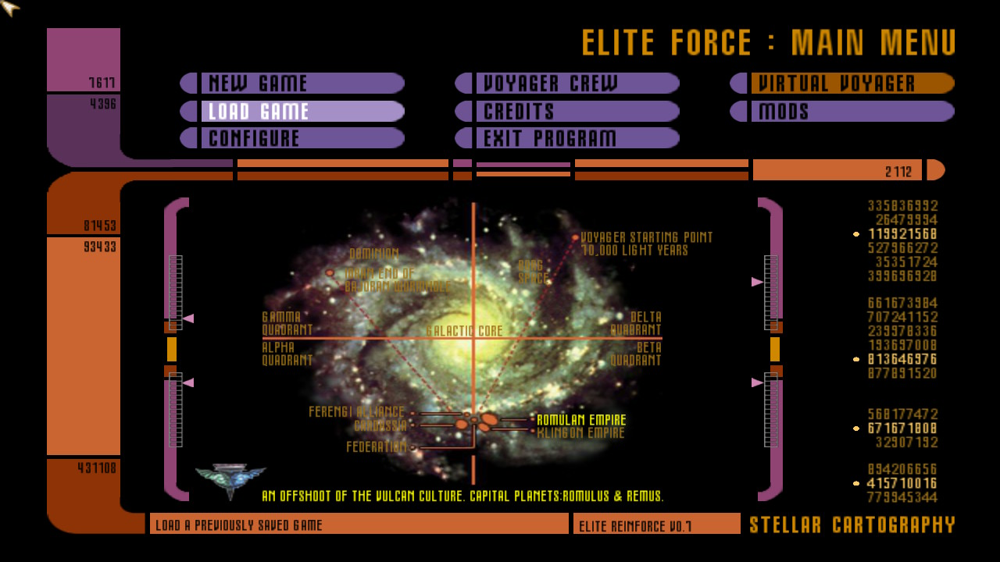
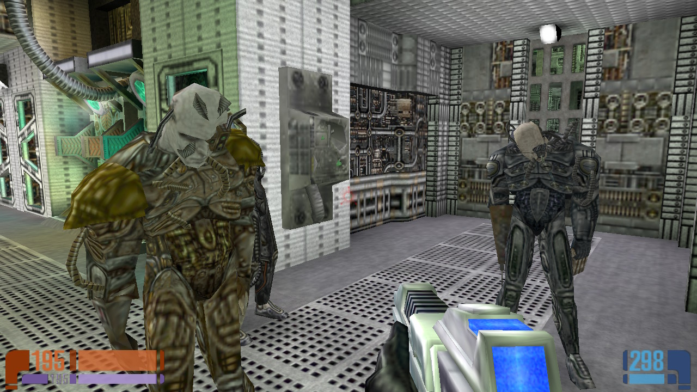
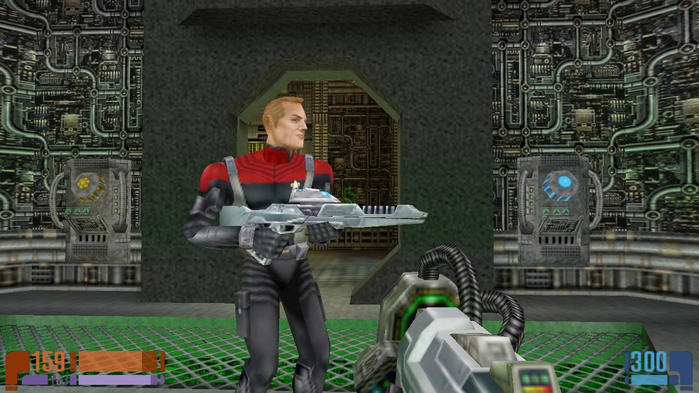
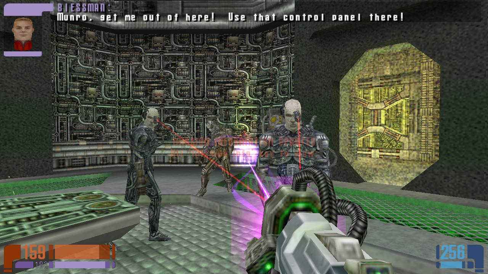
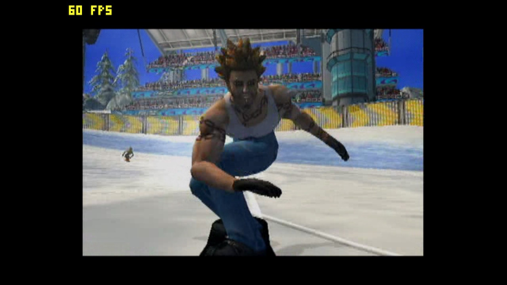
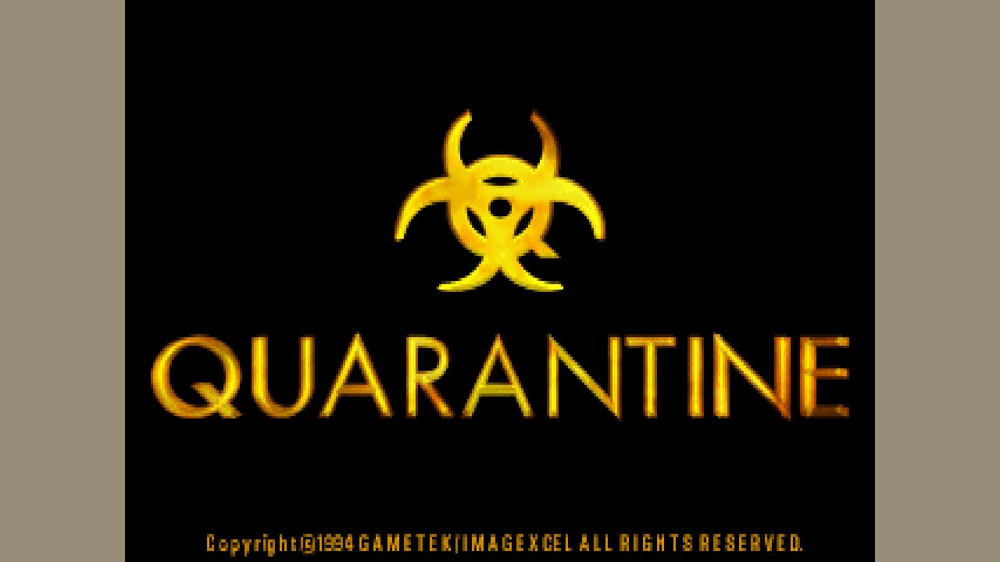
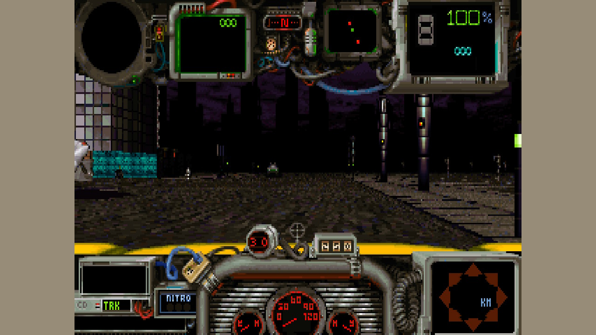
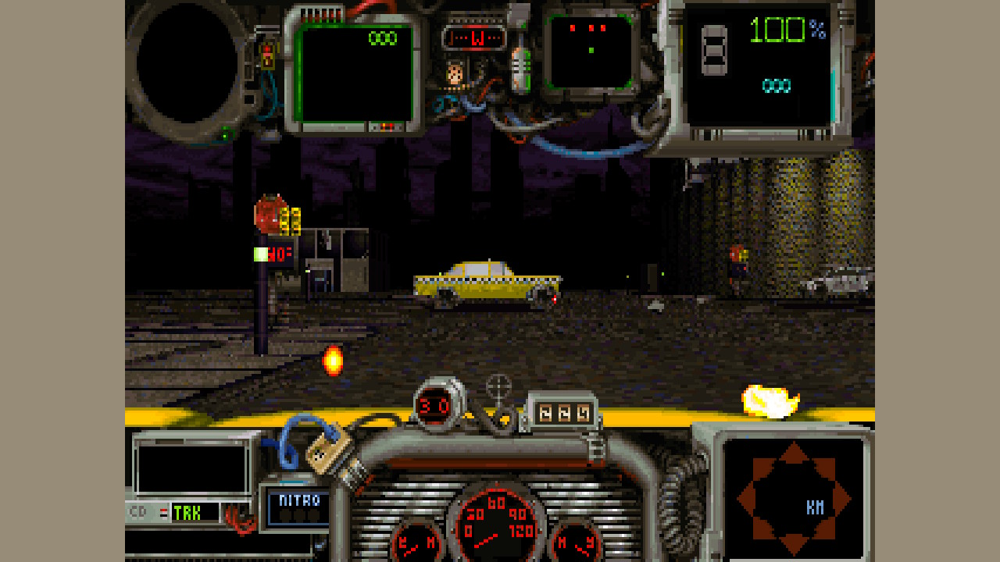

I'm still hard at work on decompiling and porting Pool of Radiance to the Nintendo DS.  I'm also still very much hard at work on Dunking Sheep, my agentic operating system (now written in rust).  

However stoic and unaffected by trends I like to think I am, when something catches my eye I'm powerless to stop myself from diving in. With all of the decomps coming out, there's something new every day to try, and remix, and just have fun with. So here are a couple Switch ports (and a port fix) that I've released this past month in the meantime. 

## Star Trek: Elite Force

This is a fun game, and the multiplayer was already ported to switch a few years back. Finished the job for single player, you can find it here: 
https://github.com/huntergdavis/elite-force-switch

## OpenTrickyNX

Someone else slopped a port out, but didn't test the controls. I opened a PR to fix, working great. 

https://github.com/huntergdavis/OpenTrickyNX

## QuarantineNX

Quarantine 1994 was a silly fun DOS game that was kind of ahead of it's time.  It's a mix of crazy taxi and carmageddon.  I was having fun playing the decomp on OSX and realized it'd be an easy switch port.  Working well and it was a very quick port. 

## Methodology: 

These are obviously heavily AI assisted.  That's most of development now. I think the more interesting thing is how cheaply I was able to do it. I've got my own DS harness that handles task assignment and coordination.  My default team composition consists of one luna low writer, two terra low reviewers, and one terra low coordinator and planner.  The planner does a deep dive and cuts it up into small tasks. The writer takes one task at a time.  Code review goes through typical git/github mechanics, with branch protection and 2-reviewer sign-off. This can slow projects significantly but also catch real bugs and implementation issues early. If the project warrants it, cicd release through github with test runners. Couple of back and forth testing rounds with me. 250 million tokens, or about 9$ at API rates (this was subscription rates on a 100/mo plan, so actual cost to me 1$ or less)

That's a wild number. 9$ to go from "I wish I had this game I used to play on this console I like to play on now." to "I'm playing it!" in a few hours. Half the cost of a movie ticket (or half the cost of a candy bar if you're subsidized by a trillion dollar corporation's subscription plan) to share something with the world and help another gamer rekindle a lost memory. Obviously these represent the best case scenario: a straight port job where the source has already been decompiled. For more esoteric fare (i.e. pool of radiance), i'm weeks into a decompile job and i'd say i'm less than halfway there.  As model abilities continue to improve, I expect that number will drop significantly. Until then, I'm just enjoying building something. What a wild world we live in today!
